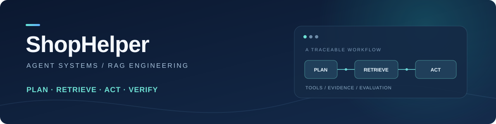
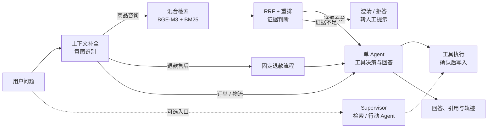

<p align="center">
  
</p>

<p align="center">
  <strong>一个能查资料、调用工具，并可追踪与评估的电商售后 Agent 原型</strong>
</p>

<p align="center">
  
  
  
  
  
</p>

<p align="center">
  <a href="#项目概览">项目概览</a> ·
  <a href="#系统架构">系统架构</a> ·
  <a href="#评测结果">评测结果</a> ·
  <a href="#快速开始">快速开始</a> ·
  <a href="#项目文档">项目文档</a>
</p>

---

## 项目概览

ShopHelper 面向**模拟电商售后**：用户可以询问商品与政策、查询订单与物流，或发起退款和工单。系统将知识检索、业务工具与 Agent 决策组合起来，并保留可追溯的证据和评测记录。

| 能力 | 实现方式 |
| --- | --- |
| **任务编排** | LangGraph 串联意图识别、固定退款流程与 ReAct 工具调用；另提供可选的 Supervisor 多 Agent 和单 / 多 Agent 路由。 |
| **知识检索** | 多轮指代补全与受护 Query 改写 → BGE-M3 稠密向量 + Milvus BM25 → RRF → Cross-Encoder 重排 → 引用与证据判断。 |
| **工具执行** | 内置工具与 MCP 统一注册；参数校验、超时与重试；工单写入先经用户确认，并支持确认键幂等。 |
| **上下文与可观测性** | 分层历史和摘要预算、SSE 流式响应；Langfuse 追踪、调用与费用台账，以及低置信问题回流。 |
| **质量评测** | 保存题集、逐题轨迹、失败与配对结果；分别检查检索覆盖、答案、澄清和拒答。 |

> 项目使用自建模拟商品、订单和售后资料，真实模型调用用于实验；结果不代表线上客服效果。

## 系统架构



默认聊天入口为 `POST /api/chat`。Supervisor 多 Agent 使用独立的 `POST /api/multi-agent/chat`；单 / 多 Agent 自适应路由需显式开启。知识检索使用混合检索与重排；受控多轮 RAG、证据面选择和缓存均可按配置开启，见[功能开关](#功能开关与边界)。

## 评测结果

以下为**模拟场景的小规模同题对照**。表中分母、开发 / 留出来源及费用口径均可在报告中追溯。

| 方向 | 基线 | 方案 | 结果说明 |
| --- | --- | --- | --- |
| **单 / 多 Agent 路由** | 固定单 Agent `20/24`；固定多 Agent `18/24` | 自适应 `22/24` | 留出 24 题；模型费用较固定多 Agent 降低 `58.2%`。评分经事后修订并统一重评。 |
| **完整证据覆盖** | `13/20` | `18/20` | 新增 20 题，前五条须覆盖全部必需证据组；配对 `6` 增 `1` 失。 |
| **答案质量** | `94/126` | `102/126` | 126 道证据答案题，同模型生成、规则检查与匿名模型裁判；包含开发及已见题，评分经事后统一修订。 |
| **重复查询缓存** | 检索阶段冷 P50 `739.8 ms` | 热 P50 `35.8 ms` | 8 轮重复请求；不含 Query 改写、答案生成或进程冷启动。 |

检索覆盖表示“是否找齐资料”，**不等于最终答案正确率**。新增 20 题仍是小样本；证据面规则依赖当前语料结构。完整报告保留分桶、逐题结果、代价和失败案例：

- [自适应路由对照](docs/eval/adaptive-routing-r2-report.md)
- [证据面检索实验](docs/eval/retrieval-evidence-slate-report.md)
- [答案质量与评分修订](docs/eval/answer-quality-depth-report.md)
- [RAG 深度补强集成验收](docs/eval/rag-depth-final-acceptance.md)

## 快速开始

**环境：**Python 3.10+、Docker、可用的对话模型与 BGE 嵌入服务。MySQL 使用 Docker；Milvus Lite 使用本地文件。下面以 Linux / WSL 为例。

```bash
git clone https://github.com/1012-Penn/ShopHelper.git
cd ShopHelper
python3 -m venv .venv

# 安装主链路依赖；主题分类器训练另需 PyTorch / Transformers
.venv/bin/pip install fastapi==0.141.1 uvicorn==0.52.4 \
  langchain==1.4.0 langchain-openai==1.6.0 'langgraph>=1.2.11,<2' \
  pydantic-settings==2.15.0 pyyaml==6.0.3 httpx==0.28.1 \
  'pymilvus[milvus-lite]==3.0.1' jieba==0.42.1 mcp==1.30.0 \
  langchain-mcp-adapters==0.3.2 jsonschema==4.26.0 \
  'sqlalchemy>=2.0' pymysql cryptography 'langfuse>=3.8,<5' \
  pytest==9.1.1 pytest-asyncio==1.4.0

cp .env.example .env
# 编辑 .env：填写对话模型及嵌入服务的 API 配置；不要提交密钥
docker compose up -d
# 等待 MySQL 就绪；执行可靠性索引迁移
# 以下账号为 docker-compose.yml 中的本地演示账号
docker exec -i shophelper-mysql mysql -ushophelper -pshophelper \
  --default-character-set=utf8mb4 shophelper < db/reliability-review-index.sql
.venv/bin/python -m db.seed
.venv/bin/python -m db.seed_conversations
.venv/bin/python -m scripts.build_kb
.venv/bin/uvicorn app.main:app --port 8000
```

启动后打开 <http://127.0.0.1:8000/>；接口文档位于 <http://127.0.0.1:8000/docs>。建库和真实对话会调用外部模型服务，请按所用供应商的价格与配额配置。

更完整的环境变量、数据库迁移、MCP 服务及故障排查见[详细技术手册](docs/technical-reference.md)。

## 功能开关与边界

| 能力 | 默认状态 | 使用方式 / 边界 |
| --- | --- | --- |
| 单 Agent 聊天 | 默认入口 | `POST /api/chat`，包含持久 run、SSE 重放及只读任务恢复。 |
| Supervisor 多 Agent | 独立可选入口 | `POST /api/multi-agent/chat`；与默认聊天入口的恢复、用量持久化语义不同。 |
| 自适应单 / 多 Agent 路由 | 关闭 | `ADAPTIVE_ROUTING_ENABLED=true` 后使用 `POST /api/adaptive-routing/chat`。 |
| 受控多轮 RAG | 关闭 | `RETRIEVAL_ROUTE=decompose_once` 或 `controlled_loop`；当前需按语料重新校准。 |
| 证据面选择 | 关闭 | `RETRIEVAL_EVIDENCE_SLATE_ENABLED=true`；按当前语料验证，换语料应重评。 |
| 静态检索缓存 | 关闭 | `RETRIEVAL_CACHE_ENABLED=true`，必须设置 `RETRIEVAL_CACHE_CORPUS_VERSION`，语料更新时同步更换版本；不缓存订单状态或生成答案。 |
| 受护 Query 改写 | 开启 | `QUERY_GUARD_ENABLED=false` 可回滚；不安全改写回退原句。 |

当前完整业务链仍是演示原型。外部物流 / 售后 MCP 为模拟服务；跨会话长期记忆、真实生产效果和大规模并发能力不在已验证结论内。真实应用组合冒烟中仍发现引用支持待复核的案例，具体见[验收报告](docs/eval/rag-depth-final-acceptance.md)。

## 项目文档

- **运行与迁移**：[详细技术手册](docs/technical-reference.md) · [环境变量模板](.env.example)
- **系统与评测**：[集成验收](docs/eval/rag-depth-final-acceptance.md) · [逐题评测目录](tests/eval/) · [知识库](knowledge/)
- **主要代码**：[Agent 编排](app/graph/) · [多 Agent](app/multi_agent/) · [检索](app/retrieval.py) · [工具](app/tools/)

运行测试：

```bash
.venv/bin/python -m pytest -q
```

最近一次集成回归为 `1213 passed, 2 skipped, 1 xfailed`；具体环境和限制见[集成验收](docs/eval/rag-depth-final-acceptance.md)。
